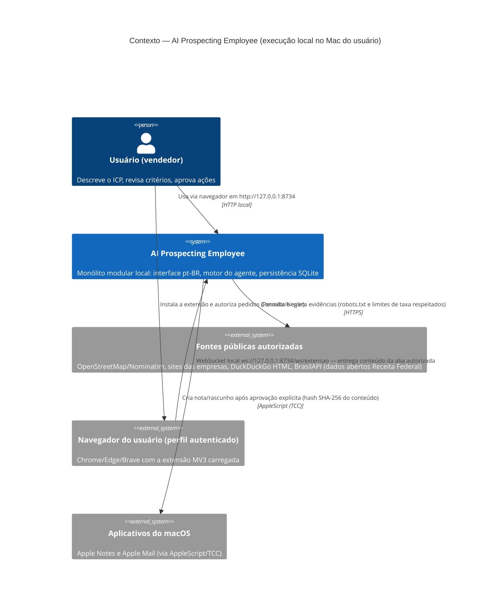

# C4 — Nível 1: Diagrama de contexto

## Notas do nível de contexto

- O usuário é a **única fonte de autorização** para ações externas e para o uso do
  navegador autenticado.
- Nenhum sistema externo recebe dados privados: as requisições às fontes carregam apenas
  consultas de pesquisa e User-Agent próprios; o WebSocket da extensão escuta somente em
  `127.0.0.1`.
