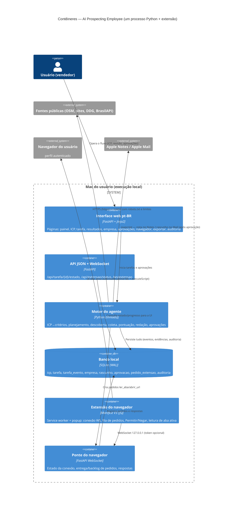

# C4 — Nível 2: Diagrama de contêineres

## Notas do nível de contêineres

- **Um único processo** (`app/main.py` — FastAPI/Uvicorn) hospeda `ui`, `api` e `ponte`;
  o `motor` roda em threads do mesmo processo (monólito modular).
- A **extensão** é o único componente dentro do navegador; comunica-se exclusivamente com
  `127.0.0.1` e não tem permissões de leitura de cookies/histórico no manifest.
- O **banco** é o contrato entre motor e interface (estados, eventos e resultados
  sobrevivem a reinícios do processo).
