# C4 — Nível 3: Diagrama de componentes (processo `app.main`)

```mermaid
C4Component
  title Componentes do processo local (módulos reais de app/)

  Container_Boundary(processo, "app.main — FastAPI/Uvicorn (um processo)") {
    Component(rotas, "app.web.routes.router", "FastAPI router", "Páginas pt-BR: painel, ICP/critérios, pesquisa, tarefa+cancelar, resultados, empresa+rascunho, aprovações, ação-local/notes, extensão, exportar, auditoria")
    Component(api_json, "app.web.api.api_router", "FastAPI router", "GET estado da tarefa, status da extensão, estado do pedido; WS /ws/extensao")
    Component(templates, "app.web/templates + static", "Jinja2 + JS vanilla", "Render server-side; polling de progresso (app.js)")

    Component(tarefas, "app.engine.tasks.gerenciador_tarefas", "TaskManager", "criar/iniciar/cancelar; TaskContext.check() = cancelamento+prazo; eventos de histórico")
    Component(icp_mod, "app.engine.icp", "módulo", "extrair_criterios() determinístico; consultas_pesquisa()")
    Component(pesquisa, "app.engine.research", "módulo", "executar_pesquisa(): descoberta → coleta → qualificação → persistência; tentativas/backoff; dedup")
    Component(evidencia, "app.engine.evidence", "módulo", "html_para_texto, extrair_pagina, coletar_evidencias, hash_conteudo")
    Component(pontuacao, "app.engine.scoring", "módulo", "pontuar(): atendido/parcial/inferido/ausente com pesos e explicação")
    Component(redacao, "app.engine.drafting", "módulo", "redigir()/redigir_assistido() — só fatos coletados; LLM opcional")
    Component(aprovacoes, "app.engine.approvals", "módulo", "solicitar() com SHA-256; decidir(); _executar_aprovada() re-verifica hash")
    Component(llm, "app.engine.llm", "módulo", "cliente opcional compatível com OpenAI; falha ⇒ fallback determinístico")

    Component(nominatim, "app.adapters.nominatim", "conector", "busca POIs (1 req/s, UA próprio, filtro de classes de estabelecimento)")
    Component(sites, "app.adapters.sites", "conector", "robots.txt, CAPTCHA/bloqueios, coleta com limite de tamanho")
    Component(websearch, "app.adapters.websearch", "conector", "DDG HTML; BuscaBloqueada em 202/anomaly/captcha")
    Component(brasilapi, "app.adapters.brasilapi", "conector", "consulta CNPJ (dados abertos Receita)")
    Component(macos, "app.adapters.macos_apps", "adaptador", "osascript: notes_criar_nota, mail_criar_rascunho; erro TCC −1743 traduzido")
    Component(browser_bridge, "app.adapters.browser.ponte_navegador", "BrowserBridge", "atender(ws), criar_pedido(), aguardar_resposta(), backlog e token opcional")
    Component(db_mod, "app.db", "módulo", "SQLite WAL: schema, inserir/atualizar/listar, auditoria")
    Component(config_mod, "app.config", "módulo", ".env sem dependências; limites e caminhos")
  }

  Rel(rotas, tarefas, "inicia pesquisas; cancela tarefas")
  Rel(rotas, aprovacoes, "solicita e decide aprovações")
  Rel(rotas, db_mod, "lê/grava via helpers")
  Rel(api_json, browser_bridge, "entrega conexão WS da extensão")
  Rel(tarefas, pesquisa, "executa executar_pesquisa(ctx, params)")
  Rel(pesquisa, icp_mod, "derivadas consultas dos critérios")
  Rel(pesquisa, nominatim, "descoberta de candidatos")
  Rel(pesquisa, websearch, "achar site oficial; trata BuscaBloqueada")
  Rel(pesquisa, sites, "coleta páginas; trata BloqueioDetectado")
  Rel(pesquisa, brasilapi, "enriquecimento por CNPJ (página oficial)")
  Rel(pesquisa, evidencia, "extrai evidências e metadados")
  Rel(pesquisa, pontuacao, "qualifica com explicação")
  Rel(pesquisa, db_mod, "grava empresa/fontes/evidências/eventos")
  Rel(aprovacoes, macos, "executa ação aprovada (Notes/Mail)")
  Rel(aprovacoes, tarefas, "cria tarefa executora após aprovação")
  Rel(redacao, llm, "auxílio opcional de redação")
  Rel(nominatim, config_mod, "User-Agent/timeout")
  Rel(db_mod, config_mod, "caminho do banco")

  UpdateRelStyle(pesquisa, evidencia, $offsetX="-20", $offsetY="-10")
```

## Regras de dependência (implementadas)

- `engine` não importa `web` (a interface só orquestra).
- `adapters` não importam `engine` — recebem parâmetros e devolvem estruturas simples.
- Qualquer acesso a dados passa por `app.db` (um lugar para auditar/limitar).
